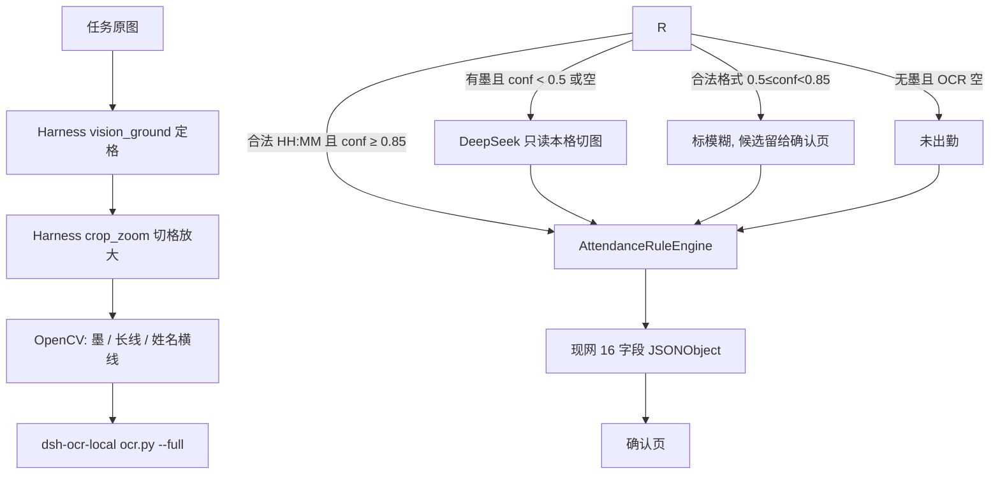

# 考勤识别技术架构（DeepSeek Harness 切格 + dsh-ocr-local 认字 + VLM 读格兜底）

> Status: implemented（MVP + P1 印刷列 OCR + P2 巡检 trace + P3 结构归一）  
> Date: 2026-10-30  
> Clients: PC Web + 飞书小程序  
> 约束：JDK 8；`/clockai/api`；任务状态机不变  
> 识别口径来源：像素巡检仪提示词（验收），不是把该提示词整段塞进模型  
> 相关：`docs/architecture-and-config.md`、`docs/data-consistency.md`

---

## 0. 产品链路（不变）

前端只上传和看结果。Harness / OCR / VLM **全部在后端**。浏览器不直连。

```text
用户选图
  → PC / 小程序上传到现网任务
  → POST /clockai/api/tasks/{taskId}/recognize
  → RecognitionRunner 读原图，交给 DeepSeek Harness
  → 原图格线定格（失败再 vision_ground）
  → Harness crop_zoom 切开并放大
  → dsh-ocr-local（ocr-serve 常驻 / ocr.py --full）认字 + 置信度
  → 少数疑难格才把「切好的小图」发给 DeepSeek Flash
  → Java 规则写成 16 字段
  → 任务 rawData → 确认页
```

---

## 1. 识别要求 = 像素巡检仪提示词（用代码落地，不用模型默写）

提示词里的「先写日志再 JSON」**不作为模型输出格式**。日志由后端 `RecognitionTrace` 按行记下；16 字段由 Java 组装。下列条款是硬验收，对应提示词三步。

| ID | 提示词条款 | 系统怎么做 |
|---|---|---|
| P1 | 绝不臆断，只基于局部像素 | 到离时间只来自**本格** crop。禁止班次、邻行、页头、示例、常识补值 |
| P2 | 长线 ≠ 空白 ≠ 整行作废 | 切格 + 去线 + OCR；有线穿过必须扫线底 |
| P3 | 步骤1 空白排查：两边都纯白无黑点，才允许未出勤 | OpenCV 墨迹；无墨且 OCR 空 → 未出勤。**有墨 OCR 空 ≠ 未出勤** |
| P4 | 步骤2 死磕长线：线当透明，找被切碎的数字 | Harness `crop_zoom` 切格放大 + 去线后再 `dsh-ocr-local`；失败才 VLM 只看本格 |
| P5 | 步骤3 拼出 `HH:MM` → 正常；糊成黑饼 → `""` + 模糊 | 规则引擎；禁止 `模糊;未出勤` |
| P6 | 第2行样例：Uscita 长斜线底下 `19:00`，标正常 | 验收样张 A |
| P7 | 第8行样例：Arrivo/Uscita 纯白 → 未出勤 | 验收样张 B |
| P8 | 第13行样例：姓名横线划掉、到离无数据 → 未出勤且已删除 | OpenCV 姓名列横线，不交给模型编 |

**明确不采用提示词的实现方式：**

- 不让 VLM 输出「像素巡检日志 + JSON 数组流」两段（占 token、和现网解析器冲突）
- 不把 GONZALEZ / SISSOKO / UDDIN 等真名示例写进任何线上 Prompt（会污染识别）
- 未出勤行 Pause 是否填 `60`：跟现网国家 Pause 规则，不因第8行示例强制写 60

**明确不采用 DeepSeek 建议里的这两条（和 P1 冲突）：**

- 「看到前面是 `08:00`，推断离开是 `12:00`/`17:00`」→ 臆断，禁止
- 「切图 Prompt 写：前面是 `10:00`，请猜离开时间」→ 禁止。VLM 只能看**这一格**的像素

---

## 2. 分工：切格和认字都走 DeepSeek Harness 插件

切格子 **不由 Java 自己算 bbox、自己 crop**。定位、切开、放大全部用 Harness 插件；Java 只编排调用顺序、做墨迹/划线检测和规则判定。

| 谁 | 插件 / 工具 | 干什么 | 不干什么 |
|---|---|---|---|
| **定格** | 原图印刷格线（`TableGridLocator`）；失败再 `vision_ground` | 竖线按贯通强度选 10 条边（禁止按间距合并列宽）；横线定行；内缩避开格线；Flash 只读页头 | 不写死列宽比例、不认数字 |
| **Harness 切格** | `dsh-crop-zoom` CLI → `crop_zoom` | 按框从**原图**裁切，长边放到约 800，手写 `nearest`，最多 16×；CLI 按 8 格一批并行 | 不认字 |
| **Harness OCR** | `dsh-ocr-local` → `ocr-serve`（同 `ocr.py --full`） | 常驻进程加载一次 ONNX，对切好的格图出文本 + 置信度 | 不判定正常/未出勤 |
| **OpenCV（Java）** | — | 切好的格上：有无墨、长斜线、姓名横线 | 不切图、不认字 |
| **DeepSeek Flash** | 现网 Key | 仅有墨低分格：读这一小块切图 | 不看整页、不猜邻行、不切格 |
| **Java** | `DeepSeekHarnessClient` + 规则引擎 | 按序调上述工具；写标记和 16 字段 | 不实现切图算法 |

不把整页丢进 dsh 聊天窗让 agent 自由发挥（会静默 OCR、会编 16 字段）。后端按工具契约依次调用，效果等同 Harness 工具链。

**切格（`crop_zoom`）契约**（与插件 JSON 一致）：

```json
{
  "path": "/abs/page.png",
  "regions": [
    {"x": 820, "y": 410, "width": 90, "height": 36, "label": "r2-uscita"}
  ],
  "target": 800,
  "mode": "nearest",
  "sheet": false
}
```

坐标是**原图像素**。若 `vision_ground` 在预览图上取点，传 `previewWidth` 让 crop_zoom 映射回原图。输出每格一张 PNG，再交给 `dsh-ocr-local`。

**OCR 契约**（插件 `ocr_image` 同源，不走聊天，避免 vision 模型下静默）：

```text
{pythonPath} scripts/dsh-ocr-serve.py --ocr-script {ocr.py} --model-dir {modelDir}
stdin JSONL: {"id":"...","path":"/abs/cell.png"} → stdout 同行契约 {lines,blocks}
```

---

## 3. 目标数据流



印刷列（姓名、中介、班次、页头日期/仓库、Pause、签字有无笔迹）同样 **切格 + OCR**，不走整页 VLM。整页 VLM 只保留在 `pipeline=legacy`。

---

## 4. 置信度路由（Java，禁止模型自己标）

阈值可配，默认取建议值。

```yaml
attendance:
  recognition:
    pipeline: ${RECOGNITION_PIPELINE:ocr_primary}  # legacy | ocr_primary
    ocr:
      enabled: true
      engine: dsh-ocr-local
      plugin-root: ${DSH_OCR_PLUGIN_ROOT:}          # …/node_modules/dsh-ocr-local
      python-path: ${DSH_OCR_PYTHON:}               # setup.py 生成的 venv，默认 ~/.dsh-ocr/venv/bin/python
      model-dir: ${DSH_OCR_MODELS:}                 # 默认 ~/.dsh-ocr/models
      timeout-ms: 8000
      # 插件 --full：行级 confidence 是检测分；rec softmax 平坦，不要当「认对概率」
    harness:
      enabled: true
      profile: attendance
      crop-plugin: dsh-crop-zoom
      ground-plugin: dsh-vision-router
      zoom-target: 800
      zoom-max-scale: 16
      zoom-mode: nearest
      prefer-cli: true
      max-vlm-cells-per-page: 24
      vlm-parallelism: 8
    rule:
      accept-threshold: 0.85    # ≥ 采信
      review-threshold: 0.50    # 中间档模糊
      ignore-long-line: true
      ink-dark-ratio: 0.028
```

| 条件 | 动作 |
|---|---|
| 合法 `HH:MM` 且 `conf ≥ accept-threshold` | 写入时间 |
| 合法格式且 `review ≤ conf < accept` | 标记**模糊**，**保留 OCR 候选**给确认页（人几秒能改）。`rule.blur-keep-text: false` 时可改成清空 |
| `conf < review` 或 `low_confidence=true` 或非法 / OCR 空，且 **有墨** | 本格切图 → VLM；VLM 仍无合法时刻 → 时间 `""`，模糊 |
| OCR 空且 **无墨**（两边都如此） | 未出勤。**禁止**「OCR 空 ⇒ 未出勤」不看墨 |
| 姓名列贯穿横线，且到离无墨 | `isDeleted=true`，未出勤，时间清空（P8） |
| 仅一侧合法时间 | 缺卡，禁止叠未出勤 |

VLM 请求：`thinking.disabled`，`temperature=0`，只允许  
`{"time":"HH:MM"| "","illegible":bool}`。  
Prompt 只描述本格：长线是划改不是空白；禁止任何「前面是 xx 请猜」。

---

## 5. 组件（C4 容器级）

```text
PC / 小程序
  → /clockai/api 现网上传 + POST /tasks/{id}/recognize
      → RecognitionRunner（多图、心跳、Key 池，沿用）
          → StructuredRecognitionPipeline
              ├─ DeepSeekHarnessClient
              │    ├─ vision_ground（dsh-vision-router）定位格
              │    └─ crop_zoom（dsh-crop-zoom）切格放大
              ├─ CellInkAnalyzer / LongLineRemover / NameStrikeDetector
              ├─ DshOcrLocalClient（dsh-ocr-local / ocr.py --full）
              ├─ DeepSeekCellAdvisor（仅疑难格）
              └─ AttendanceRuleEngine
          → task.rawData
```

不新开上传 Controller。密钥走 `DeepSeekKeyPool`（`DEEPSEEK_API_KEY` / `_N` / `DEEPSEEK_API_KEYS`，默认 8 把）：`vision_ground` 与疑难格 Flash 按池轮询。切格走 crop-zoom CLI，OCR 走本机常驻 serve。

**`DeepSeekHarnessClient`（切格）**

```text
List<CellCrop> groundAndCrop(byte[] pagePng, String country);
// 1) vision_ground：返回 [{row, field: ARRIVEE|DEPAR|NAME|..., x,y,w,h}] 原图像素
// 2) crop_zoom CLI：每格写出放大 PNG（target=800, mode=nearest, sheet=false）
```

禁止 Java 用固定比例估「页宽 48%–78%」当格子（现网 `ClockCellInkDetector` 那套在 `ocr_primary` 下停用）。ground 失败：该页标结构失败，行全部模糊，不静默当未出勤。

**`DshOcrLocalClient`（认字）**

```text
CellOcrResult ocrCell(Path cropPng);
// ocr-serve JSONL（失败再一次性 ocr.py --full）
// { lines: [{text, confidence, font_px, low_confidence}], blocks: [...] }
```

规则侧：行 `text` 拼接后抽 `HH:MM`；置信度取最低行分；任一 `low_confidence=true` 视为低于 `review-threshold`。

### 5.1 服务器一次性安装 Harness 插件（同一 profile）

```sh
npx -y @deepseek-ai/dsh@alpha plugin --profile attendance add dsh-vision-router
npx -y @deepseek-ai/dsh@alpha plugin --profile attendance add dsh-crop-zoom
npx -y @deepseek-ai/dsh@alpha plugin --profile attendance add dsh-ocr-local
python3 ~/.dsh/profiles/attendance/node_modules/dsh-ocr-local/ocr/setup.py
python3 ~/.dsh/profiles/attendance/node_modules/dsh-ocr-local/ocr/ocr.py --doctor
```

`application.yml` 指向该 profile 的 plugin-root / venv / `~/.dsh-ocr/models`。启动时 `--doctor`，`ok!=true` 则禁止 `ocr_primary`，可回 `legacy`。

---

## 6. 规则引擎判定顺序

纯 Java，对应提示词步骤 1–3。

```text
1. 姓名列贯穿横线 且 到离无墨
     → 未出勤, isDeleted=true, 时间清空          // P8
2. 到或离 有墨 且 无合法 HH:MM（含 VLM 之后）
     → 模糊, 不得标未出勤                         // P3/P5
3. 到与离都无墨
     → 未出勤, isDeleted=false                     // P7
4. 仅一侧合法 HH:MM
     → 缺卡
5. 两侧合法且达采信阈（或模糊档保留候选）
     → 正常或模糊; 再叠夜班/手写
```

姓名格「划掉旧名 + 另有新名」：提示词无样例。本架构：**同格有未划掉的第二段文字则不当已删除**，输出新名（避免改名行被整行作废）。P8 只覆盖「划掉且到离无数据」。

---

## 7. 验收（提示词样例 → 测试）

| # | Given | Then |
|---|---|---|
| A | Uscita 跨 2–7 行长斜线，线底 `19:00` | `DEPAR=19:00`，非未出勤，非班次抄写 |
| B | Arrivo/Uscita 纯白 | 未出勤，到离 `""`，`isDeleted=false` |
| C | 有墨、OCR/VLM 都读不成 `HH:MM` | `""` + 模糊 |
| D | 姓名横线划掉、到离无数据 | 未出勤，`isDeleted=true` |
| E | `pipeline=legacy` | 现网整页 VLM 行为 |

前端确认页、粘贴恢复、识别正确锁定：零改，仍吃 16 字段。

---

## 8. 对外 API / 库表

不新增 API。不新增表（MVP）。回滚：`RECOGNITION_PIPELINE=legacy`。

---

## 9. 分期

| 阶段 | 范围 | 状态 |
|---|---|---|
| **MVP** | Harness `vision_ground` + `crop_zoom` 切到离格 + OpenCV 墨/线 + **dsh-ocr-local** 认字 + 规则引擎；VLM 仅有墨低分格 | 已落地 |
| **P1** | 印刷列同样 Harness 切格再 OCR；国家列名给 `vision_ground` | 已落地 |
| **P2** | trace 记下 ground 框、crop 路径、OCR `lines[]`（巡检日志） | 已落地 |
| **P3** | 结构更稳（列名别名 / xyxy 框 / 按 Y 分行 / 缺格模糊）；不引入 dsh 聊天窗当识别入口 | 已落地 |

---

## 10. 风险

| 风险 | 处理 |
|---|---|
| OCR 把斜线认成 `1` | 先去线再 OCR；无墨不采信单个 `/` `1` |
| OCR 空被当成未出勤 | 强制墨迹门闩（P3） |
| VLM 抄班次 | 读格请求不含班次/邻行 |
| 走 dsh 聊天调 OCR | 多模态下插件静默；Java 必须直调 `ocr.py --full` |
| 插件环境未 setup | 启动 `--doctor`；失败禁止 `ocr_primary` |
| 检测分 ≠「认对概率」 | 采用插件 `low_confidence`；中档一律进确认页 |
| `vision_ground` 切错行/列 | 外扩 bbox；失败该格模糊，禁止用页宽比例估格 |
| Java 自己 crop | `ocr_primary` 禁止；切格只许 `crop_zoom` |

---

## 11. 决策摘要

| ID | 决策 |
|---|---|
| ADR-H1 | 入口仍是任务 recognize |
| ADR-H2 | 切格只许 Harness：`vision_ground` + `crop_zoom`；OCR 只许 `dsh-ocr-local`；VLM 只读疑难格 |
| ADR-H7 | 不把识别跑进 dsh 聊天窗；Java 按工具契约调插件（vision 下 `ocr_image` 会静默） |
| ADR-H8 | 禁止 Java 按页宽比例切到离格（停用 `ClockCellInkDetector` 估带）；印刷格线求格可以 |
| ADR-H3 | 像素巡检仪提示词 = 验收与规则，不是线上 VLM 全文 |
| ADR-H4 | 禁止用邻行/班次猜时间 |
| ADR-H5 | OCR 空必须先看墨，才能标未出勤 |
| ADR-H6 | 已删除 = OpenCV 姓名列横线 + 到离无墨，不靠模型 |
